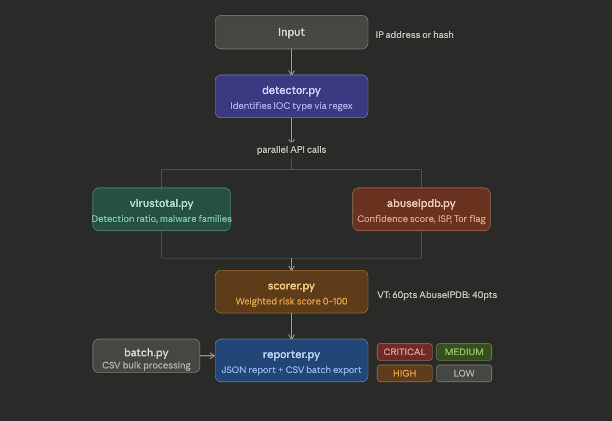

# IOC Enrichment Pipeline

A Python-based threat intelligence tool that automates investigation of suspicious IPs and file hashes by querying multiple threat intel APIs and generating structured risk reports.

Built as a SOC home lab project to simulate real analyst triage workflows.

---

## Features

- Supports IP addresses and file hashes (MD5, SHA1, SHA256)
- Queries VirusTotal and AbuseIPDB APIs in parallel using ThreadPoolExecutor
- Weighted risk scoring engine (0–100) with severity levels
- JSON report output per IOC with timestamp
- Batch processing via CSV input for multi-IOC triage
- Graceful per-enricher error handling — one API failure does not break the pipeline
- API keys stored securely in `.env` — never hardcoded

---

## Architecture

```
Input (IP or Hash)
        ↓
   detector.py  →  identifies IOC type via regex
        ↓
  ┌─────┴──────┐
  │  parallel  │
  ▼            ▼
virustotal.py  abuseipdb.py
  │            │
  └─────┬──────┘
        ↓
   scorer.py   →  weighted risk score (VT: 60pts, AbuseIPDB: 40pts)
        ↓
  reporter.py  →  JSON report + CSV batch export
```

---

## File Structure

```
ioc-enrichment/
├── main.py                  # Entry point — single IOC investigation
├── config.py                # Loads API keys from .env
├── detector.py              # IOC type detection via regex
├── enrichers/
│   ├── __init__.py
│   ├── virustotal.py        # VirusTotal API enricher
│   └── abuseipdb.py         # AbuseIPDB API enricher
├── core/
│   ├── __init__.py
│   ├── scorer.py            # Risk scoring engine
│   └── reporter.py          # JSON + CSV output
├── batch.py                 # Batch CSV processor
├── requirements.txt
├── .env                     # API keys (never committed)
└── .gitignore
```

---

## Setup

### 1. Clone the repo

```bash
git clone https://github.com/zaghamarshad/ioc-enrichment.git
cd ioc-enrichment
```

### 2. Install dependencies

```bash
pip install -r requirements.txt
```

### 3. Configure API keys

Create a `.env` file in the project root:

```
VT_API_KEY=your_virustotal_key
ABUSE_API_KEY=your_abuseipdb_key
```

Get free API keys from:
- VirusTotal: https://www.virustotal.com
- AbuseIPDB: https://www.abuseipdb.com

---

## Usage

### Single IOC — IP address

```bash
python main.py 185.220.101.45
```

### Single IOC — file hash

```bash
python main.py 44d88612fea8a8f36de82e1278abb02f
```

### Batch processing

```bash
python batch.py iocs.csv
```

CSV must contain a column with header `ioc`. Example:

```
ioc
185.220.101.45
44d88612fea8a8f36de82e1278abb02f
8.8.8.8
```

---

## Sample Output

```json
{
  "ioc": "185.220.101.45",
  "ioc_type": "ip",
  "timestamp": "2025-03-10T14:22:05Z",
  "risk_score": 87,
  "risk_level": "CRITICAL",
  "risk_reasons": [
    "VT flagged by 32/70 engines",
    "AbuseIPDB confidence: 95%",
    "IP is a Tor exit node"
  ],
  "virustotal": {
    "malicious_engines": 32,
    "total_engines": 70,
    "detection_ratio": 0.46,
    "malware_families": ["Mirai", "Hajime"]
  },
  "abuseipdb": {
    "confidence_score": 95,
    "total_reports": 847,
    "country_code": "DE",
    "isp": "Tor Project",
    "is_tor": true
  }
}
```

---

## Risk Scoring

| Score  | Level    | Logic                                      |
|--------|----------|--------------------------------------------|
| 75–100 | CRITICAL | High VT detections + high abuse confidence |
| 50–74  | HIGH     | Moderate detections or high abuse reports  |
| 25–49  | MEDIUM   | Low detections or low confidence score     |
| 0–24   | LOW      | Clean across both sources                  |

Scoring weights:
- VirusTotal detection ratio → up to **60 points**
- AbuseIPDB confidence score → up to **40 points**
- Tor exit node bonus penalty → **+5 points**

### What to do with the score

- CRITICAL or HIGH: check where the IOC was seen in your own logs first, then note the VirusTotal and AbuseIPDB reasons in the ticket before escalating.
- MEDIUM: keep the report, watch for the same IOC again, and check if other hosts talked to it.
- LOW: record the result and close the check, unless the IOC came from a confirmed incident, in which case context matters more than the score.
- A score is a starting point for triage, not proof on its own. A clean result does not clear a host that shows other signs of compromise.

### Tips for batch triage

- Remove duplicate IOCs from the CSV before a run. Free API keys have daily limits, and repeat lookups waste them.
- Run a small batch first and check the reports look right before running a large list.
- Keep the JSON report for each IOC with the ticket or notes for that check, so the score and its reasons can be reviewed later without running the lookup again.

### When one source fails

One failed lookup does not break the run, and the report still holds what the other source returned. Treat a missing source as missing data, not as a clean result: the score was built from fewer points than usual. Note which source failed in the ticket, and run the IOC again later if the score is close to an escalation line or the IOC came from a confirmed incident.

### Reading a hash result

A hash lookup answers a different question from an IP lookup. A hash with many detections points to a known bad file, but a hash with no detections only means the sources have not flagged that exact file. Check where the file came from and which host ran it before closing the check, and keep the hash report with the host details from your own logs.

### Reading an IP result for a shared address

A flagged IP is not always one actor. Cloud hosts, VPN exits, and office NAT addresses are shared by many users at once, so the same address can carry normal traffic and bad traffic in the same hour. Check the exact time window from your own logs, the port and the user agent where you have them, and record the shared address note in the ticket before treating the result as belonging to one host or user.


### Before sharing a report

A JSON or CSV report is safe to attach to a ticket, but check it before sending it wider. The report should hold the IOC, its type, the score and its reasons, and the timestamp. It should not hold API keys, and keys belong only in the local .env file, never in a report or a screenshot of one. If notes added by hand name an internal host or user that the reader does not need, remove that name and keep the host count and the time window instead, so the result can still be checked later.

### Checking how fresh a result is

A score is only as current as the data behind it. Before acting on a result, check when each source last saw or scanned the IOC. An IP flagged months ago may have changed hands since then, and a hash with an old scan date may have newer detections that the cached result does not show. If the underlying data is old and the decision matters, run the lookup again and note both timestamps in the ticket.

### Keep the original IOC with the report

Save the IOC exactly as it was received, before any cleanup or formatting, alongside the report. A trimmed URL, a defanged address written back in full, or a hash copied with a missing character can change what was checked. Keeping the original form makes it possible to confirm later that the lookup matched the alert that started the check.

### Note the context where the IOC was seen

Keep a short note with the report saying where the IOC came from in your own environment: the alert or ticket that raised it, the host and user involved if known, and the direction of the traffic or how the file arrived. The same IOC can be urgent on one host and routine on another, and that context is what lets a later reader judge the score instead of just repeating it.

### When the same IOC appears in two alerts

If the same indicator turns up in a second alert, do not run and file it as a separate case by default. Check the report from the first run, link the two tickets, and note the second host or user in the first report. Run a fresh lookup only when the first result is old or the second sighting changes the picture, such as a different host running the same file. Keeping one report per IOC stops two analysts from reaching two different calls on the same indicator.

### Recording a domain result with care

A domain result needs its own note. Record the full domain as seen, including any subdomain, because a clean parent domain does not clear a subdomain and a flagged subdomain does not prove the parent is bad. Note whether the lookup checked the domain itself or a URL built on it, and keep that detail with the report so the next reader checks the same thing.

---

## IOC Types Supported

| Type    | VirusTotal | AbuseIPDB |
|---------|------------|-----------|
| IP      | Yes        | Yes       |
| MD5     | Yes        | Skipped   |
| SHA1    | Yes        | Skipped   |
| SHA256  | Yes        | Skipped   |

AbuseIPDB only supports IP addresses. Hash lookups route to VirusTotal only and are scored accordingly.

---

## Technologies

Python · VirusTotal API · AbuseIPDB API · REST APIs · Threat Intelligence · IOC Analysis · SIEM Integration · Security Automation

---

## Future Improvements

- Splunk HEC integration to forward enriched IOC data into a SIEM dashboard
- Add Shodan enrichment for open port and CVE data
- MITRE ATT&CK technique mapping based on malware families detected
- Web dashboard for visualizing batch report results
- SQLite local caching to avoid redundant API calls on repeated IOCs

---

## Author

**Zagham Arshad**
- LinkedIn: https://linkedin.com/in/zaghamarshad
- GitHub: https://github.com/zaghamarshad
